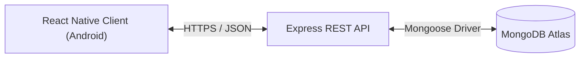

# Modulus Todo

Modulus Todo is a task management application comprising an Express REST API with MongoDB and an Android client built with React Native. It provides user authentication, task scheduling, dynamic urgency prioritization, and offline-resilient local state management.

<p align="center">
  
  
  
  
</p>

## Features

- User authentication with stateless JWT access tokens and rotating refresh tokens
- Task CRUD operations with scheduling dates, deadlines, priority levels, and custom tags
- Task sorting by creation date, deadline, priority, or dynamic urgency score
- Task filtering by status (all, pending, completed) and text search across titles and descriptions
- Optimistic UI updates with automatic rollback on network failure
- Token and session storage encrypted using the Android Keystore (via react-native-keychain)

## Architecture & Tech Stack

- **Backend**: Node.js (>=22), Express 5, MongoDB (Mongoose 9), Argon2id, JSON Web Tokens (HS256), Pino, express-rate-limit, Helmet
- **Mobile**: React Native 0.88, React 19, React Navigation (native stack), Zustand 5, react-native-keychain, @react-native-community/datetimepicker



## Running Locally

### Prerequisites

- Node.js >= 22.11.0 and npm
- Android SDK (API 34+) and command-line tools
- Running MongoDB instance (`docker run -d -p 27017:27017 --name mongo mongo:latest` or a MongoDB Atlas URI)

### Backend Setup

```bash
cd backend
npm install
cp .env.example .env   # configure MONGODB_URI and JWT_ACCESS_SECRET
npm run dev            # starts dev server on http://localhost:5000
npm test               # executes backend Vitest test suite
npm run lint           # verifies ESLint compliance
```

Generate a cryptographically secure 32-byte secret for `JWT_ACCESS_SECRET` using:
```bash
node -e "console.log(require('crypto').randomBytes(32).toString('hex'))"
```
or
```bash
openssl rand -hex 32
```

### Mobile Setup

```bash
cd mobile
npm install
npm start              # starts Metro bundler
npm run android        # builds and launches debug APK on emulator/device
npm test               # executes mobile Jest test suite
npm run lint           # verifies ESLint compliance
```

When testing on a physical Android device instead of an emulator, replace the loopback URL in `mobile/src/config.ts` with your development machine's LAN IP address.

## Environment Variables

Backend environment configuration (`backend/.env` validated via `backend/src/config/env.ts`):

| Variable | Purpose | Required | Default |
| :--- | :--- | :--- | :--- |
| `PORT` | HTTP port for the Express API server | No | `5000` |
| `NODE_ENV` | Runtime environment (`development`, `production`, `test`) | No | `development` |
| `MONGODB_URI` | MongoDB connection string URI | Yes | - |
| `CORS_ORIGIN` | Allowed CORS origin header for browser requests | No | `*` |
| `JWT_ACCESS_SECRET` | Secret key for signing HS256 access tokens (min 32 characters) | Yes | - |
| `ACCESS_TOKEN_TTL` | Access token validity duration string | No | `15m` |
| `AUTH_RATE_LIMIT_WINDOW_MS` | Time window in milliseconds for login/register rate limiting | No | `900000` (15m) |
| `AUTH_RATE_LIMIT_MAX` | Maximum login/register requests allowed per rate limit window | No | `20` |
| `REFRESH_TOKEN_TTL_DAYS` | Refresh token validity lifetime in days | No | `30` |
| `REFRESH_GRACE_SECONDS` | Concurrency grace period in seconds for refresh token rotation | No | `10` |
| `REFRESH_RATE_LIMIT_MAX` | Maximum token refresh requests allowed per rate limit window | No | `60` |
| `REFRESH_RATE_LIMIT_WINDOW_MS` | Time window in milliseconds for refresh rate limiting | No | `900000` (15m) |

## API Documentation

Complete endpoint specifications, request/response envelopes, and error contracts are documented in [docs/api.md](docs/api.md).

## Design Notes

- Argon2id is used for password hashing because it is memory-hard and provides resistance against GPU and ASIC cracking attacks.
- 15-minute access tokens are explicitly pinned to the HS256 algorithm to prevent algorithm switching ('none') attacks.
- 30-day refresh tokens are stored as SHA-256 hashes in MongoDB with a 10-second reuse grace window to handle mobile network retries.
- Per-user data isolation is enforced at the database query level (`{ _id: id, userId }`), returning 404 on not-found to prevent enumeration.
- Urgency score formula computed dynamically on query: completed tasks receive -1; overdue tasks receive 10000 * weight + min(overdueHours, 336) * 10; upcoming tasks receive (1000 / (hoursLeft + 1)) * weight (halved if scheduled start is in the future); priority weights are high 3, medium 2, low 1.
- The mobile API client implements a single-flight refresh queue to prevent stampeding the refresh endpoint on concurrent 401 responses.
- Auth credentials on Android are encrypted using the Android Keystore (via react-native-keychain).
- Task mutations employ optimistic Zustand updates that reflect immediately in the UI and automatically roll back on network failure.

## Known Limitations

- Access tokens are stateless with a 15-minute lifetime until expiration.
- Free Render hosting tier cold-starts can take up to about a minute on initial requests; the mobile client timeout is set to 60s.
- The mobile release APK is signed with the Android debug keystore for submission evaluation.
- Binary builds are compiled for 64-bit Android architectures (`arm64-v8a` and `x86_64`).
- iOS is not built or supported for this submission.

## Download & Deployment

- Release APK: <APK_LINK>
- Live Production API: `https://modulus-todo.onrender.com`
