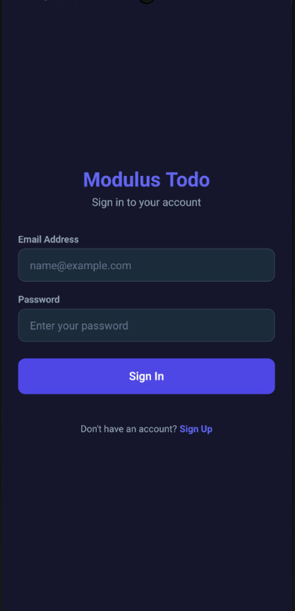
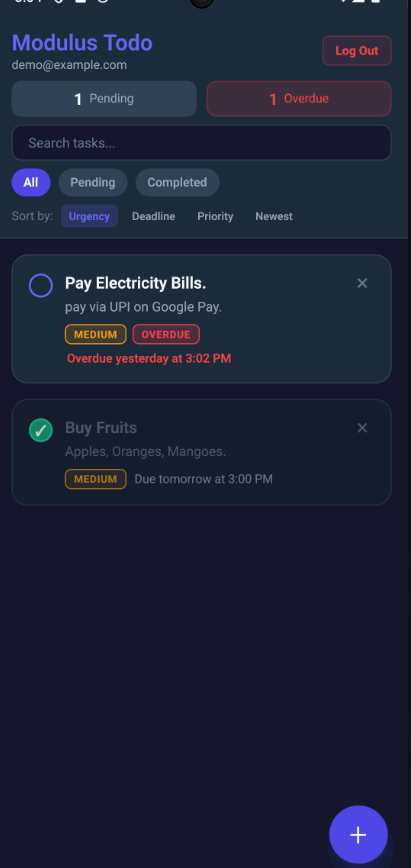
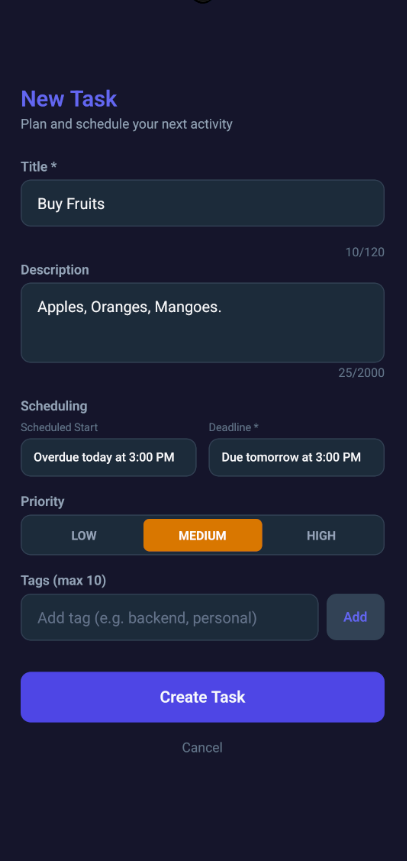
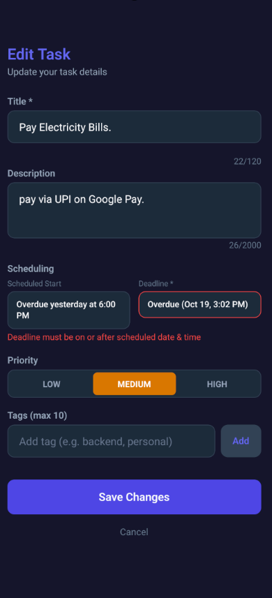
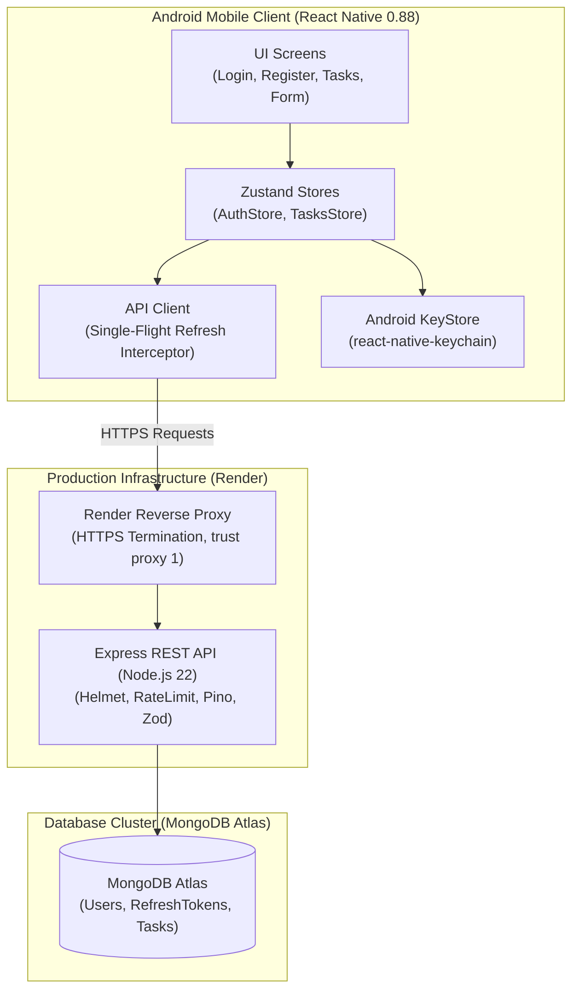

# Modulus Todo

A modern, production-grade Android To-Do application built with React Native CLI, TypeScript, Node.js, Express, and MongoDB Atlas.

Download the APK: <APK_LINK>

Production API: https://modulus-todo.onrender.com

---

## 1. Overview & Features

Modulus Todo provides task organization with intelligent urgency ranking, multi-attribute filtering, and real-time optimistic interactions.

### Key Features
- **User Authentication**: Secure signup and login backed by Argon2id password hashing, 15-minute access JWTs, and rotating 7-day refresh tokens stored in the Android KeyStore.
- **Task Management**: Full CRUD capabilities supporting titles (up to 120 chars), rich descriptions (up to 2000 chars), priority levels (Low, Medium, High), tags (up to 10), scheduled start times, and deadlines.
- **Intelligent Urgency Ranking**: Dynamic urgency scoring that evaluates remaining time to deadline, priority weighting, overdue status, and start damping.
- **Optimistic UI**: Circular completion toggles reflect updates immediately on the device with rollback on network failure.
- **Filtering & Search**: Debounced search bar with filter chips (All, Pending, Completed) and instant sort criteria (Urgency, Deadline, Priority, Newest).
- **Native Android DateTime Pickers**: Two-step modal flow for selecting date followed by time using `@react-native-community/datetimepicker`.
- **Production Hardened**: HTTPS-only transport, strict JSON schemas (Zod), single-flight refresh interceptor, and zero cleartext traffic in release builds.

---

## 2. Screenshots

| Login & Auth | Task List & Urgency | Create Task | Client Validation |
| :---: | :---: | :---: | :---: |
|  |  |  |  |

---

## 3. Tech Stack & Architecture

### Tech Stack
- **Mobile Client**: React Native 0.88, TypeScript, React Navigation (Native Stack), Zustand, React Native Keychain, `@react-native-community/datetimepicker`, React Native Safe Area Context, React Native Screens.
- **Backend API**: Node.js 22+, Express, TypeScript, Mongoose, Argon2id, Zod, Pino / Pino-Http, Helmet, CORS, Express-Rate-Limit.
- **Database & Hosting**: MongoDB Atlas (replica set with TTL and compound indexes), deployed on Render (reverse proxy with HTTPS).
- **Testing**: Jest, Vitest, Supertest, React Test Renderer.

### Architecture Diagram


---

## 4. Setup Guide (Windows)

### Prerequisites
- Node.js >= 22.x and npm
- Android Studio with Android SDK Platform 34/35 and Android SDK Build-Tools
- JDK 17 (Microsoft OpenJDK 17 or Azul Zulu 17)
- Android Virtual Device (AVD) running Pixel 6 API 34+

### Backend Setup
1. Navigate to the backend directory:
   ```powershell
   cd C:\mt\backend
   ```
2. Copy the environment configuration file:
   ```powershell
   cp .env.example .env
   ```
3. Install dependencies:
   ```powershell
   npm install
   ```
4. Run the development server (runs on port 5000):
   ```powershell
   npm run dev
   ```
5. Run the test suite:
   ```powershell
   npm test
   ```

### Mobile Setup
1. Navigate to the mobile directory:
   ```powershell
   cd C:\mt\mobile
   ```
2. Install dependencies:
   ```powershell
   npm install
   ```
3. Start the Android emulator and reverse network ports (for local development against `http://10.0.2.2:5000` or localhost):
   ```powershell
   adb reverse tcp:8081 tcp:8081
   adb reverse tcp:5000 tcp:5000
   ```
4. Launch the application:
   ```powershell
   npm run android
   ```

### Environment Variables (Backend)

| Variable Name | Purpose |
| :--- | :--- |
| `PORT` | HTTP port for the Express application server |
| `NODE_ENV` | Application runtime environment (`development`, `test`, `production`) |
| `MONGODB_URI` | Connection URI for the MongoDB database instance |
| `JWT_SECRET` | Secret key used for signing and verifying HS256 access tokens |
| `JWT_EXPIRES_IN` | Expiration timeframe for access tokens (e.g. `15m`) |
| `REFRESH_TOKEN_EXPIRES_DAYS` | Lifespan of refresh tokens in days before MongoDB TTL expiry (e.g. `7`) |
| `REFRESH_GRACE_SECONDS` | Concurrency grace window in seconds for refresh token rotation (e.g. `10`) |
| `AUTH_RATE_LIMIT_WINDOW_MS` | Sliding rate limiter window for authentication endpoints in milliseconds |
| `AUTH_RATE_LIMIT_MAX` | Maximum requests per IP permitted within the authentication window |

---

## 5. API Reference & Testing

Detailed request and response contracts, schema models, and pagination specifications are documented in [docs/api.md](docs/api.md).

### Current Test Counts
- **Backend (Vitest)**: **11 test files, 96 tests passed (100% green)**
- **Mobile (Jest)**: **4 test files, 7 tests passed (100% green)**
- **Total Project Tests**: **15 test suites, 103 tests passed**

---

## 6. Design Decisions & Security

All claims below reflect implementation verified directly in the codebase:
- **Argon2id Parameters**: Passwords are protected using Argon2id with 64 MB memory cost (`m=65536`), 3 time iterations (`t=3`), and 4 parallelism threads (`p=4`), verified in [backend/src/utils/password.ts](backend/src/utils/password.ts).
- **15-Minute Access JWTs**: Access tokens are stateless JWTs signed with HS256, pinned with issuer `modulus-todo-api` and audience `modulus-todo-app`, and expire after 15 minutes, verified in [backend/src/utils/jwt.ts](backend/src/utils/jwt.ts).
- **Opaque Refresh Tokens with SHA-256 Hashes**: Refresh tokens are 32-byte cryptographically random hex strings whose raw values are never stored; only their SHA-256 digests reside in MongoDB with TTL indexing, verified in [backend/src/services/token.service.ts](backend/src/services/token.service.ts).
- **Grace Siblings & Family Revocation on Reuse**: Token rotation tracks family IDs and allows a 10-second grace window for concurrent requests while revoking the entire token family immediately upon detecting reuse, verified in [backend/src/services/token.service.ts](backend/src/services/token.service.ts).
- **Rate Limiting**: Rate limiting via `express-rate-limit` enforces 200 requests/15m globally, 30 requests/15m on token refresh, and 10 requests/15m on register/login with standard `RateLimit-*` headers, verified in [backend/src/app.ts](backend/src/app.ts) and [backend/src/routes/auth.routes.ts](backend/src/routes/auth.routes.ts).
- **NoSQL-Injection-Safe Validation**: All incoming request bodies and query parameters pass through strict Zod schemas that sanitize types, escape search regexes, reject prototype keys, and enforce constraints, verified in [backend/src/middleware/validate.middleware.ts](backend/src/middleware/validate.middleware.ts).
- **Per-User Ownership Isolation**: Every query filters by the authenticated token's `userId`; requests for non-existent IDs or tasks belonging to another user consistently return `404 Not Found` rather than `403` to prevent ID enumeration, verified in [backend/src/services/task.service.ts](backend/src/services/task.service.ts).
- **Redacted Logging**: Structured logging via Pino and Pino-HTTP sanitizes headers, cookies, passwords, and database connection strings, completely omitting request bodies from serializer outputs, verified in [backend/src/app.ts](backend/src/app.ts) and [backend/src/config/db.ts](backend/src/config/db.ts).
- **Hermetic Tests**: Tests execute with isolated in-memory configurations without loading external `.env` files, and assert that real production hostnames are never present in the test runtime, verified in [backend/tests/env.test.ts](backend/tests/env.test.ts).
- **Keychain Token Storage**: Tokens on the mobile client are stored in the hardware-backed Android KeyStore via `react-native-keychain` instead of unencrypted AsyncStorage, verified in [mobile/src/store/auth.ts](mobile/src/store/auth.ts).
- **Single-Flight Refresh**: Concurrent API failures with 401 trigger a single shared token refresh promise so multiple simultaneous requests await the same refresh operation without race conditions, verified in [mobile/src/api/client.ts](mobile/src/api/client.ts).

---

## 7. Urgency Formula Specification

When tasks are ordered by Urgency (`sortBy=urgency`), scores are calculated identically in TypeScript and MongoDB aggregations:

### Formula
1. **Overdue Tasks (`now > deadline`)**:
   ```
   score = 10000 * priorityWeight + min(overdueHours, 336) * 10
   ```
   - Priority weights: `high: 3`, `medium: 2`, `low: 1`.
   - Priority dominates overdue ranking. The overdue penalty increases by 10 points per hour up to 336 hours (14 days).

2. **Upcoming Tasks (`now <= deadline`)**:
   ```
   timeToDeadlineHours = max(0, (deadline - now) / 3600000)
   rawScore = 1000 / (timeToDeadlineHours + 1) * priorityWeight
   score = (now < scheduledAt) ? rawScore * 0.5 : rawScore
   ```
   - Tasks whose scheduled start time has not arrived receive a 0.5 damping factor.

### Worked Examples from Unit Tests (`backend/tests/urgency.test.ts`)

| Scenario | Priority | Status | Calculation | Final Score |
| :--- | :--- | :--- | :--- | :--- |
| High priority, due in 1 hr (started) | High (3) | Upcoming | `1000 / (1 + 1) * 3` | `1500.0` |
| High priority, due in 1 hr (not started) | High (3) | Upcoming (Damped) | `1500 * 0.5` | `750.0` |
| Medium priority, due in 1 hr (started) | Medium (2) | Upcoming | `1000 / (1 + 1) * 2` | `1000.0` |
| Low priority, due in 1 hr (started) | Low (1) | Upcoming | `1000 / (1 + 1) * 1` | `500.0` |
| High priority, overdue by 2 hrs | High (3) | Overdue | `10000 * 3 + min(2, 336) * 10` | `30020.0` |
| Medium priority, overdue by 2 hrs | Medium (2) | Overdue | `10000 * 2 + min(2, 336) * 10` | `20020.0` |
| Low priority, overdue by 2 hrs | Low (1) | Overdue | `10000 * 1 + min(2, 336) * 10` | `10020.0` |
| High priority, overdue by 400 hrs (capped) | High (3) | Overdue (Cap) | `10000 * 3 + 336 * 10` | `33360.0` |

---

## 8. Known Limitations

- **Stateless Access Tokens**: Access tokens remain valid until their 15-minute expiration timeframe and cannot be individually revoked before expiration.
- **Render Free Tier Cold-Starts**: On the free hosting tier, inactive instances spin down and may take 30 to 60 seconds to boot on initial health/API requests.
- **Debug Key Signing**: The production release APK is signed with the Android debug signing keystore for evaluation purposes.
- **Dynamic Urgency Ordering**: Because urgency is time-dependent, the relative ordering of upcoming and overdue tasks naturally adjusts as time elapses.
- **Idempotent Update Timestamps**: Invoking completion with `completed: true` when the task is already completed advances MongoDB's `updatedAt` timestamp while strictly preserving the original `completedAt`.
- **In-Memory Sort Evaluation**: Priority and urgency sort criteria are computed per user collection rather than through a static persistent index.
- **iOS Target**: Development and testing have been executed exclusively on Android; iOS compilation and runtime behavior have not been verified.
