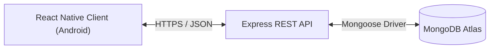

# Modulus Todo

Modulus Todo is a full-stack task management application comprising a Node.js/Express REST API backed by MongoDB and an Android client built with React Native. The application supports user authentication, task CRUD operations with priority and deadline scheduling, dynamic urgency calculation, keyword search, status filtering, and optimistic local state synchronisation.

<p align="center">
  
  
  
  
</p>

## Features

- User authentication with stateless JWT access tokens and rotating refresh tokens
- Task CRUD operations with title, description, scheduled date, deadline, priority, and tags
- Dynamic urgency scoring computed on query without background workers
- Task filtering by status (all, pending, completed) and search by keyword
- Optimistic UI updates with rollback on network failure
- Hardware-backed token and session persistence via Android Keystore

## Architecture & Tech Stack

- **Backend**: Node.js (>=22), Express 5, MongoDB (Mongoose 9), Argon2id, JSON Web Tokens (HS256), Pino, express-rate-limit, Helmet
- **Mobile**: React Native 0.88, React 19, React Navigation (native stack), Zustand 5, react-native-keychain, @react-native-community/datetimepicker



## Running Locally

### Prerequisites

- Node.js >= 22.11.0 and npm
- Android SDK (API 34+) and command-line tools
- Running MongoDB instance (`docker run -d -p 27017:27017 --name mongo mongo:latest` or MongoDB Atlas URI)

### Backend Setup

```bash
cd backend
npm install
cp .env.example .env   # configure MONGODB_URI and JWT_ACCESS_SECRET
npm run dev            # starts dev server on http://localhost:5000
npm test               # executes backend Vitest test suite
npm run lint           # verifies ESLint compliance
```

### Mobile Setup

```bash
cd mobile
npm install
adb reverse tcp:5000 tcp:5000   # forward emulator/device traffic to host backend
npm start                       # starts Metro bundler
npm run android                 # builds and launches debug APK on emulator/device
npm test                        # executes mobile Jest test suite
npm run lint                    # verifies ESLint compliance
```

## Environment Variables

Backend environment configuration (`backend/.env`):

| Variable | Purpose | Required | Default |
| :--- | :--- | :--- | :--- |
| `PORT` | HTTP port for the Express API server | No | `5000` |
| `NODE_ENV` | Execution environment (`development`, `production`, `test`) | No | `development` |
| `MONGODB_URI` | MongoDB connection URI string | Yes | - |
| `JWT_ACCESS_SECRET` | Secret key used for signing HS256 access tokens | Yes | - |
| `JWT_EXPIRES_IN` | Access token duration string | No | `15m` |
| `REFRESH_TOKEN_EXPIRES_DAYS` | Refresh token lifespan in days | No | `7` |
| `REFRESH_GRACE_SECONDS` | Concurrency grace period for refresh token rotation | No | `10` |

## API Documentation

Complete endpoint specifications, request/response envelopes, and error contracts are documented in [docs/api.md](docs/api.md).

## Design Notes

- Argon2id is used for password hashing because it is memory-hard and provides resistance against GPU and ASIC cracking attacks.
- 15-minute access tokens are explicitly pinned to the HS256 algorithm to prevent algorithm switching ('none') attacks.
- 7-day refresh tokens are stored as SHA-256 hashes in MongoDB with a 10-second reuse grace window to handle mobile network retries.
- Per-user data isolation is enforced at the database query level (`{ _id: id, userId }`), returning 404 on not-found to prevent enumeration.
- The urgency score formula (`weight * 10,000 + min(overdueHours, 336) * 10`) is computed dynamically on query without background jobs.
- The mobile API client implements a single-flight refresh queue to prevent stampeding the refresh endpoint on concurrent 401 responses.
- Auth credentials on Android are stored in the Android Keystore via `react-native-keychain`.
- Task mutations employ optimistic Zustand updates that reflect immediately in the UI and automatically roll back on network failure.

## Known Limitations

- Access tokens are stateless with a 15-minute lifetime until expiration.
- Free Render hosting tier cold-starts can take 50+ seconds on initial requests; the mobile client timeout is set to 60s.
- The mobile release APK is signed with the Android debug keystore for submission evaluation.
- Binary builds are compiled for 64-bit Android architectures (`arm64-v8a` and `x86_64`).
- iOS is not built or supported for this submission.

## Download & Deployment

- Release APK: [Download app-release.apk](https://github.com/prashant25gourav/modulus-todo/releases/download/v1.0.0/app-release.apk)
- Live Production API: `https://modulus-todo.onrender.com`
